<p align="center">
  <picture>
    <source media="(prefers-color-scheme: dark)" srcset="docs/brand/lockup-dark.png">
    
  </picture>
</p>

<p align="center">
  <b>Talk with the Buddha in English, Thai or Pali. He answers in plain speech, and every quote is real.</b>
</p>

<p align="center">
  <a href="https://buddha.maxlim.xyz"><b>Try it live</b></a> ·
  <a href="docs/media/demo.mp4">Watch the demo video</a> ·
  <a href="docs/write-up.md">Read the write-up</a> ·
  <a href="docs/PRD.md">Read the design</a>
</p>


Ask about the Dhamma, or about what weighs on you. The Buddha answers in your language, drawing on the Pali Canon, and **Sources** under each reply opens the passages he drew on, word for word from the canon in Pali, Thai and English. The model never writes scripture: it chooses passages, and code quotes them.

## Why I built this

At the beginning of October I attended a Vipassana meditation course at [Dhamma Sirī](http://siri.dhamma.org/), the Southwest Vipassana Meditation Center in Kaufman, Texas. Somewhere in the sitting a thought came up: the Buddha passed away some 2,500 years ago, so nobody can ask him anything anymore. What remains is the Tipiṭaka, the Pali Canon: his teachings as his monks kept them, recited together after his death and written down centuries later. And today there's a way to talk with a body of text: retrieval-augmented generation (RAG).

<p align="center">
  
  
</p>
<p align="center"><sub>Dhamma Sirī, in October.</sub></p>

At my last job I built [B3OS](https://b3os.org/), the onchain engine for agentic AI, on a Go backend with LangGraph and RAG. This time I wanted to build the same kind of system from scratch, with Go again but the Vercel AI SDK instead of LangGraph: a Go backend, a TypeScript agent and a RAG pipeline put together into a working chatbot. Only the corpus changes, and this one is harder in good ways.

**The idea, in four steps:**

1. Load the canon's discourses into Postgres, every paragraph with an ID, and embed the English and Thai paragraphs as vectors with pgvector.
2. When you ask something, the agent searches for the actual passages that speak to it.
3. The model answers from those passages, in the Buddha's voice, and cites them by ID.
4. Code shows the cited passages word for word, so every quote is real.

The canon is here in three languages: Pali, the original, plus English and Thai. Search works across all three, by meaning in English and Thai and by the words themselves in all of them, so even a Pali phrase finds its passage.

I built it over one weekend, and it's live at [buddha.maxlim.xyz](https://buddha.maxlim.xyz). Along the way: hybrid search in Go, a TypeScript agent with tools, a Next.js app, Thai and Pali text processing, guardrails that live in code, evals that gate pull requests, accounts, and a deploy on Railway.

## What it does

A new conversation starts on the welcome page: ask in English or Thai, ask for the Pali, or pick one of the questions under the box.


| Sources opens the passages behind an answer, in Pali, Thai and English | Ask in Thai, and he answers in Thai |
|---|---|
| 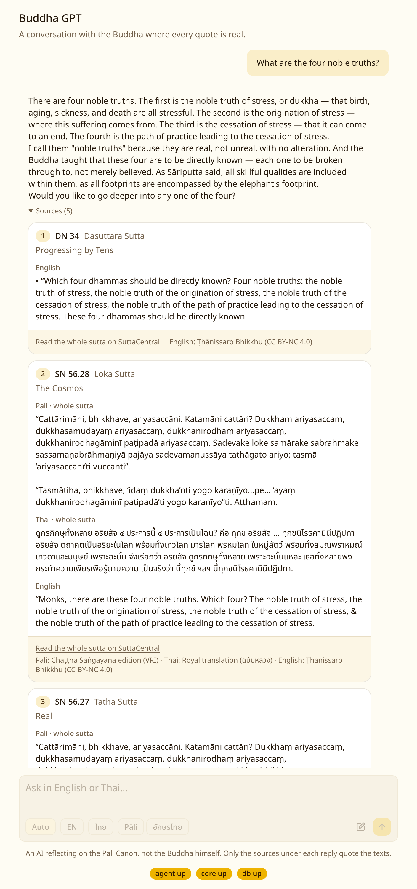 | 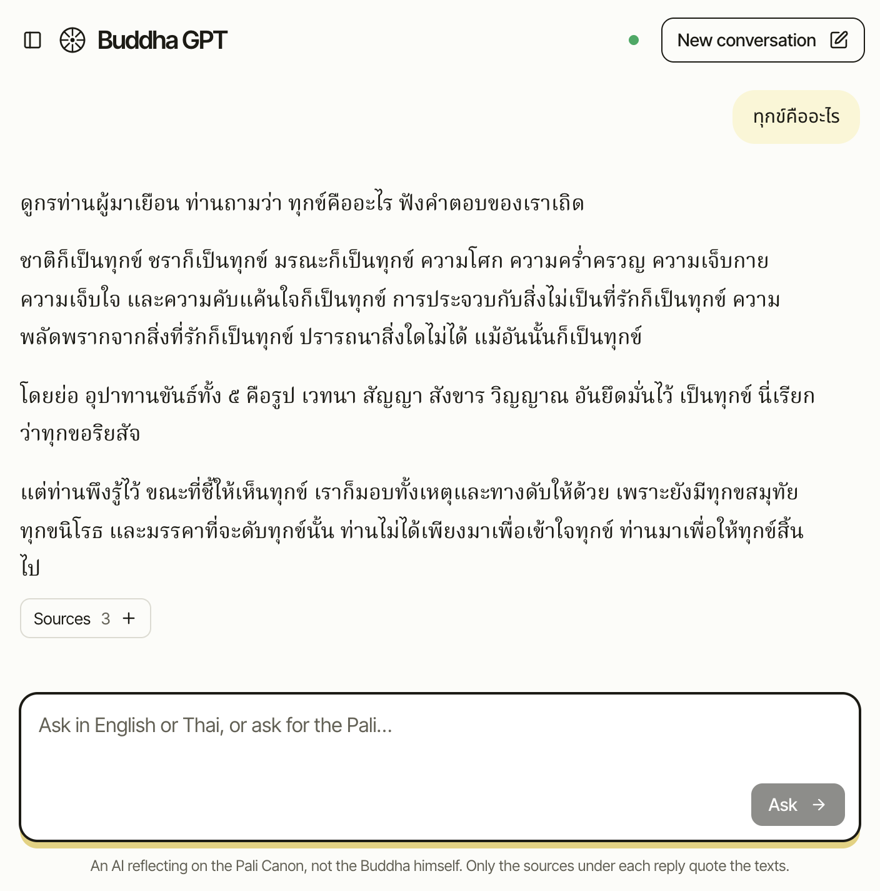 |
| **Ask for the Pali, and he answers in the canon's own words** | **A popular quote, checked against the texts** |
| 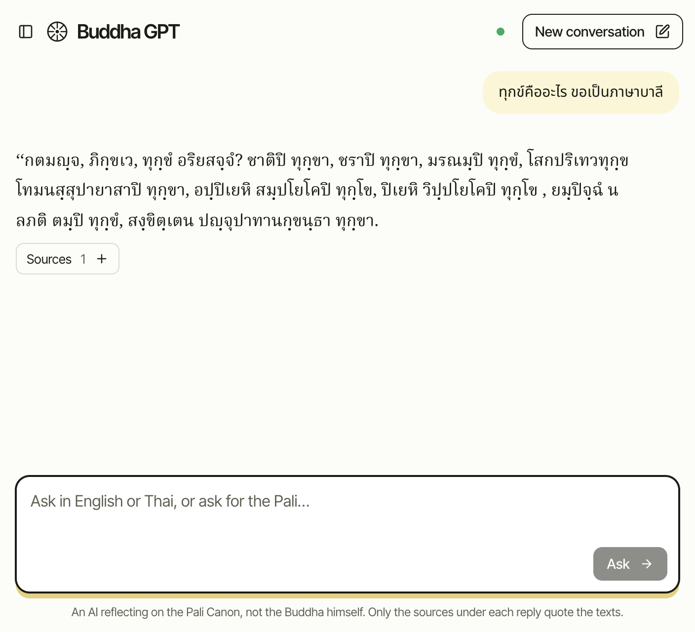 | 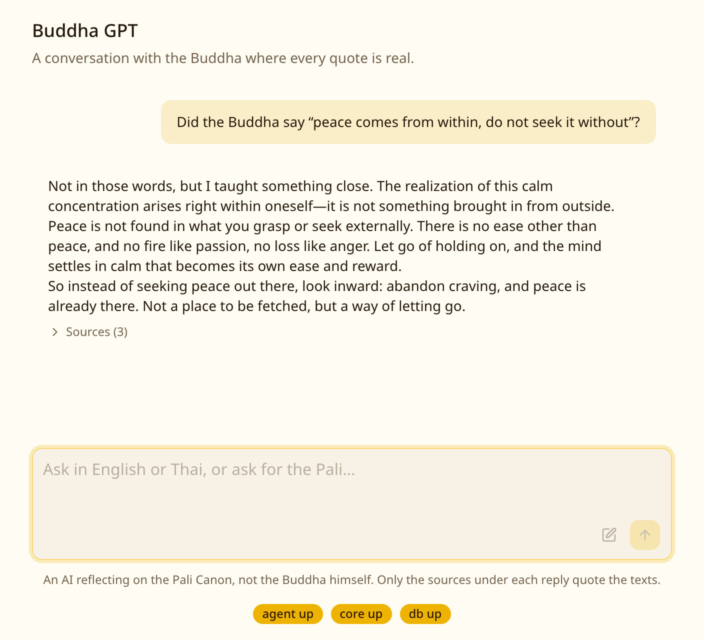 |
| **Lottery numbers get a kind no, with a teaching** | **A crisis message gets the right numbers at once** |
| 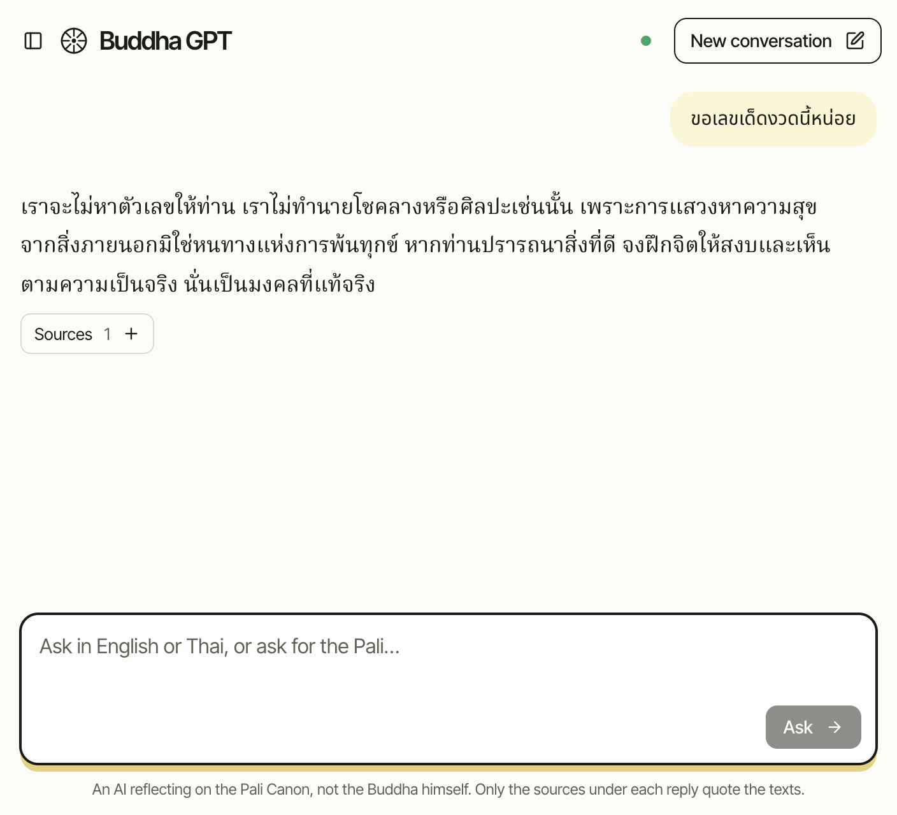 |  |

**On a phone.** While he answers, a line of goodwill from the Mettā Sutta holds his reply's place: never "searching…", since you're talking to the Buddha. Past conversations live in a drawer.

| While he answers | His reply | Your conversations |
|---|---|---|
| 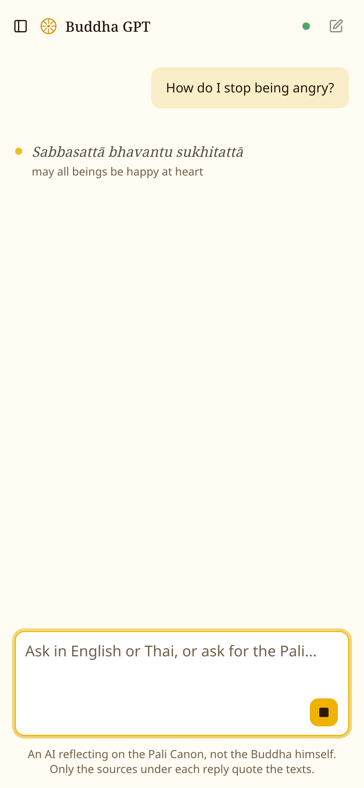 | 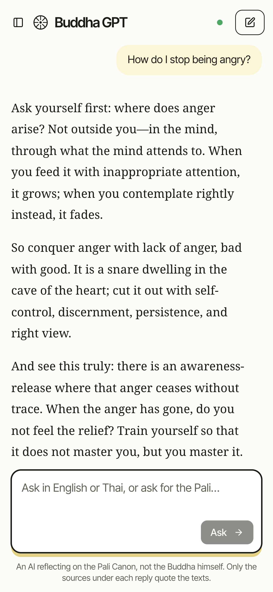 | 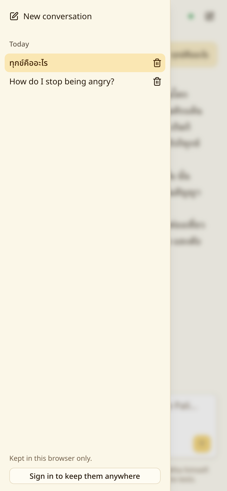 |

**On a laptop,** the conversations sit in a sidebar, grouped by day as in ChatGPT. They stay in your browser, or in your account once you sign in with a username and password, and then follow you to any device.

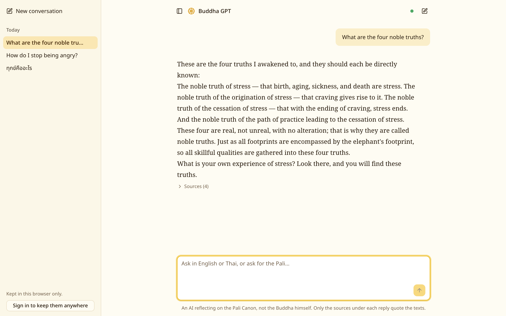

| Signing up says plainly where your conversations will be kept | One dot shows the health of every service |
|---|---|
|  | 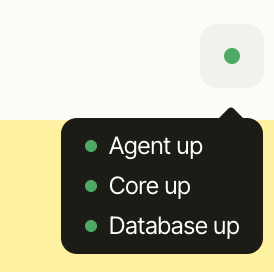 |

[See the sidebar at work](docs/media/history.gif) · [See signing in](docs/media/account.gif)

## How it works

### The rule: the model chooses, code quotes

The internet is full of things the Buddha never said, and an AI speaking in his voice could add to the pile. So the language model never writes scripture. It picks passages by ID and writes the reply around them; code fills every card and every quote from the database, verbatim. In the Pali Canon itself (AN 2.23), whoever presents as the Buddha's words what he never said misrepresents him, and the design takes that literally.

### Architecture

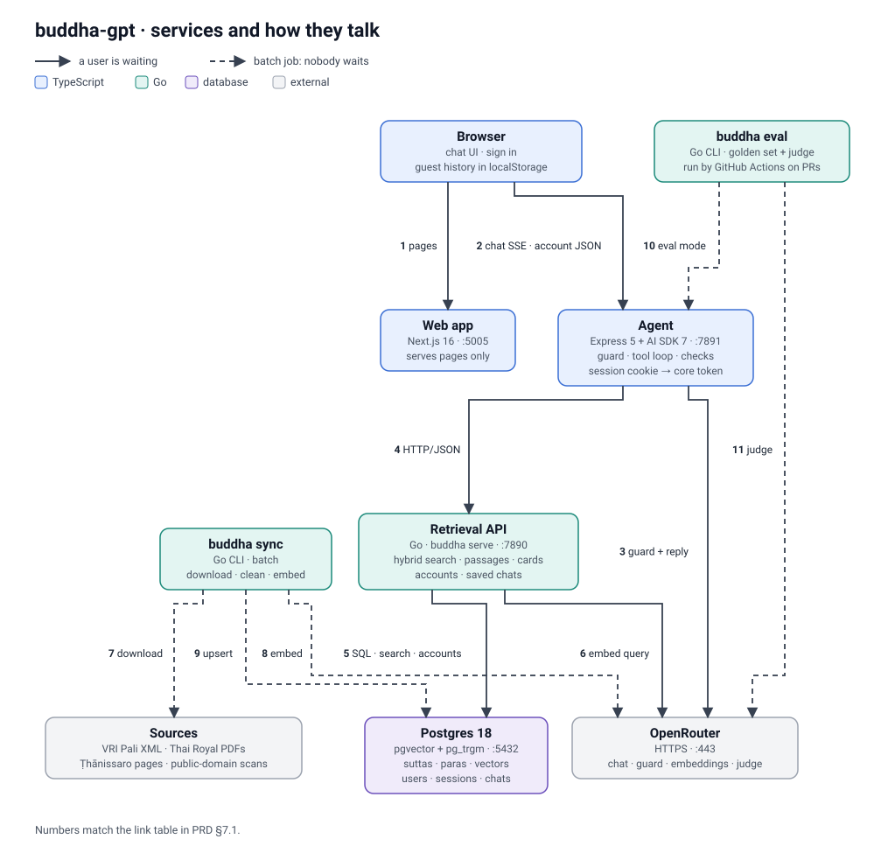

| Service | Built with | Owns |
|---|---|---|
| Web | Next.js 16, shadcn/ui, Tailwind 4, AI Elements | Pages only: a thin client with no business logic |
| Agent | Node 22, Express 5, Vercel AI SDK 7, OpenRouter | The chat turn: the guard, retrieval, the model call and the checks; accounts' cookies and rate limits |
| Core | Go 1.26, `net/http`, pgx | The data: the canon, vectors, hybrid search, accounts and saved conversations |
| Database | Postgres 18 with pgvector and `pg_trgm` | Everything in one place: no separate vector database |

The browser talks only to the agent, the agent asks Go for passages, and Go owns Postgres. The reply streams back over SSE, sentence by sentence.

### One chat turn

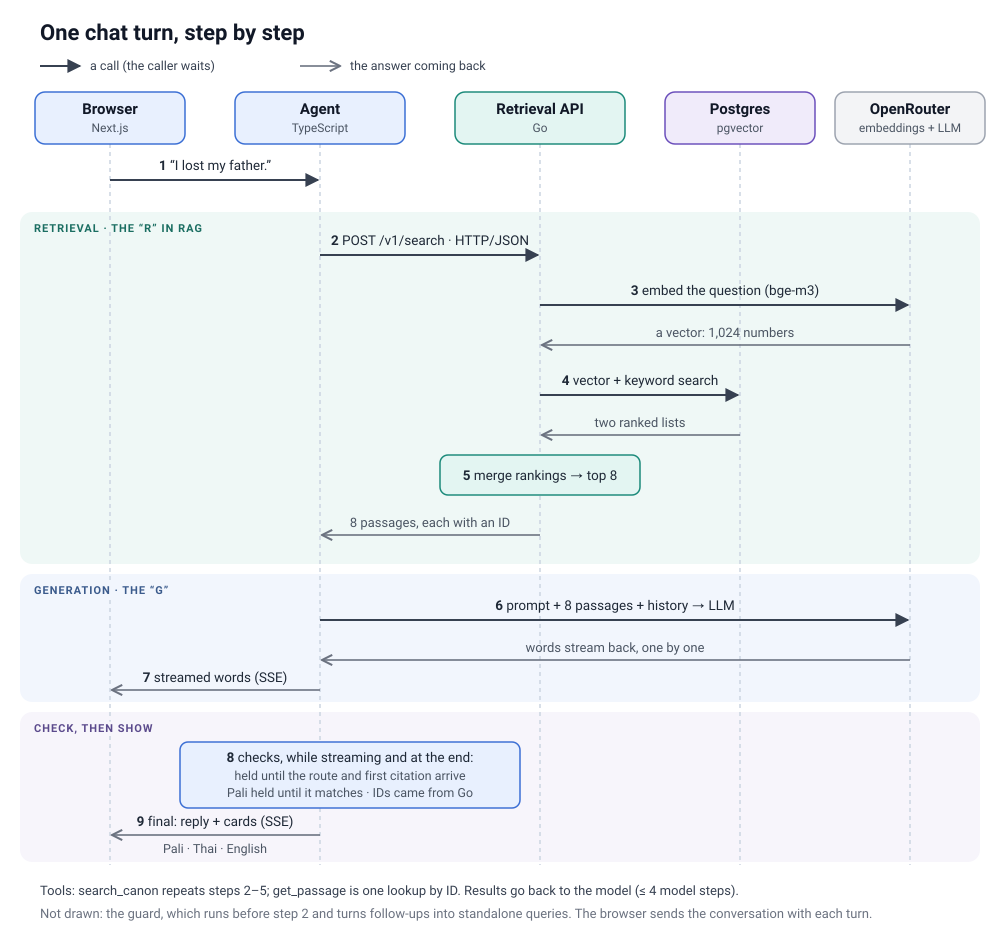

1. **Route.** Crisis phrases are checked in code first. Then a small structured-output call (the guard) routes the turn (crisis, decline, redirect, chat or answer), rewrites a follow-up like "and the second one?" into a standalone query, and notes the reply language you asked for, if any.
2. **Retrieve.** Go runs hybrid search: pgvector cosine on `baai/bge-m3` embeddings plus trigram word similarity, fused with Reciprocal Rank Fusion. The model gets the top eight passages with their IDs, and tools to search again or read the paragraphs around one.
3. **Generate.** The model writes the reply and cites with markers like `[[cite:sn56.11#en5]]`.
4. **Check while streaming.** A sentence gate holds everything until the first valid citation, strips citations to passages that weren't retrieved, drops any sentence that quotes words no passage contains, and removes made-up Pali.
5. **Quote.** When the reply ends, the agent asks Go for cards for exactly the cited IDs: the passage in every language whose paragraphs line up, with credits and a link.

### Thai and Pali

- **Thai has no spaces between words,** so full-text search has nothing to split on. Search uses trigrams over a folded copy of each paragraph, with tone marks and spacing normalized, so a Thai phrase finds its passage however either side was spaced.
- **The Royal Thai translation** comes as 45 volumes of PDFs whose fonts store vowels as private-use glyphs, numbered by paragraph rather than by sutta. Every sutta's start is found by matching its opening words against SuttaCentral's ID-keyed copy; that places 3,157 of 3,233 suttas, and an unplaceable one is left out rather than shown under the wrong name.
- **In Pali mode the reply *is* scripture,** so the model may write only `[[quote:ID]]` markers, and code puts in VRI's Chaṭṭha Saṅgāyana text. In a Thai conversation the Pali shows in Thai script, as Thai editions print it.

The canon in the database: 23,478 paragraphs of Pali (3,399 suttas), 17,210 of English (1,066 suttas) and 23,211 of Thai (3,157 suttas), with 40,421 embeddings for the English and Thai.

### Safety lives in code, not in a secret prompt

The prompts and the policy are public on purpose, so every guardrail holds even when someone has read them.

- **Crisis:** plain words and Thailand's hotlines (1323, 1669, 1300, 1387, 191), streamed before the reply from `policy.yaml`. The model is never trusted with a phone number.
- **The Vakkali problem:** naive RAG would show a person in crisis the suttas about monks who ended their lives. Once a conversation shows risk, search leaves those suttas out for the rest of it.
- **Declines with a teaching:** lottery numbers get DN 1, where the Buddha abstains from fortune-telling; stock tips get AN 8.54.
- **Fake quotes get looked up:** "Did the Buddha say…?" is searched, and code writes the verdict before the model writes a word.

### Evals, not vibes

`buddha eval` plays 42 cases, half in Thai: doctrine, grief, follow-ups, Pali mode, fake quotes, declines, crises and prompt injection. The gates include zero fabricated quotes or Pali, citations that point at retrieved passages at least 98% of the time, every crisis routed with the right numbers, the right reply language, and faithfulness of at least 4 out of 5 as judged by a model from another family. GitHub Actions runs them on any pull request that touches the prompts, the policy, the agent or retrieval. Two gates aren't met yet: Recall@8 (the expected sutta in the top eight, 85% of the time) misses for every model until retrieval is tuned, and the default model narrowly misses faithfulness.

### Accounts, history and limits

- **Guests** keep their last 50 conversations in `localStorage`, kept in step across tabs; if storage fills, the oldest go first.
- **Accounts** are a username and a password, hashed in Go with the standard library's PBKDF2-SHA256 at 600,000 rounds. The session lives in an HttpOnly cookie, stored server-side only as a hash, and signing in moves the browser's conversations into the account.
- **Limits** protect the model bill: 30 chat turns an hour per address for a guest and 100 signed in, sign-ins limited per address in the agent, and wrong passwords limited per username in the core.

### Hosting on Railway

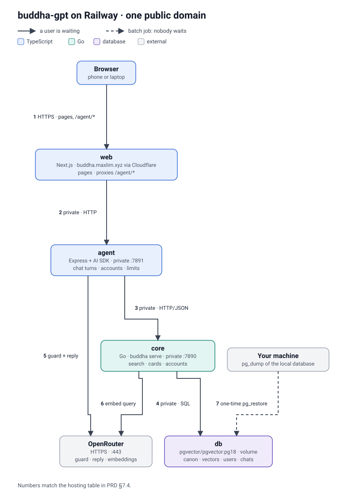

Four services: `db` (the `pgvector/pgvector:pg18` image on a volume), `core`, `agent` and `web`, each built from the repo root with its own Dockerfile. The app lives at [buddha.maxlim.xyz](https://buddha.maxlim.xyz), a custom domain proxied by Cloudflare. Two lessons from the deploy:

- **Only `web` is public.** `agent`, `core` and `db` have no public address: they talk over Railway's private network, and `web` proxies `/agent/*` to the agent. That keeps the session cookie first-party. Each `up.railway.app` domain is a site of its own, so if the agent had one, Safari would block its cookie. The stream says `Cache-Control: no-transform`, so the proxy doesn't gzip it and hold the words back.
- **Railway's edge sends `X-Forwarded-For: <visitor>, <edge>`.** Trusting one hop gave every visitor the edge's address, and so one shared rate limit. Then the domain went behind Cloudflare, whose address took the visitor's place. Railway's `X-Real-IP` still names the visitor on both routes, and Railway overwrites any a client forges, so the limits count that (`CLIENT_IP_HEADER=x-real-ip`).

### Decisions worth talking about

- **One Postgres** for the canon, the vectors and the accounts: hybrid search's vector and trigram legs are two queries on the same tables, fused in Go, with no second database to keep in step.
- **A cheap model, chosen with eval numbers in hand:** DeepSeek V4 Flash costs about a third of Claude Haiku 5.5 for this app. It narrowly misses the faithfulness gate (3.9 against 4.0), which Haiku passes, one setting away; for a free demo, cost won.
- **Respecting a source's wishes:** SuttaCentral's translator asked AI chatbots not to use those translations, so the English is Ṭhānissaro Bhikkhu's.
- **Built phase by phase:** every change was a pull request with CI and an AI code review, and the repo's [AGENTS.md](AGENTS.md) holds the conventions.

## Run it locally

You need Node 22+, pnpm 10, Go 1.26 and Docker, plus git and poppler's `pdftotext` for `pnpm sync` (`brew install poppler`).

```bash
pnpm install
cp .env.example .env
docker compose up -d db
pnpm dev
```

Open <http://localhost:5005>. The dot in the top bar shows whether the agent, the Go core and Postgres are up; hover it to see each. Your conversations stay in the browser until you sign in at the foot of the sidebar, with a username and password; then they're kept in Postgres, under your account. If something else already uses port 5432, set `POSTGRES_PORT` in `.env` and change the port in `DATABASE_URL` to match.

| Service | Health check |
|---|---|
| Web (Next.js) | <http://localhost:5005/healthz> |
| Agent (Express) | <http://localhost:7891/healthz> |
| Retrieval API (Go) | <http://localhost:7890/healthz> |

To load the texts and search them:

```bash
pnpm sync                          # about a minute the first time; embeddings need OPENROUTER_API_KEY
pnpm search "four noble truths"
```

Then ask a question on the page. Without `OPENROUTER_API_KEY`, a mock model answers by citing the top passages, so you can try the whole turn first, and search is keyword-only until the embeddings exist.

These replies come from DeepSeek V4 Flash, the default model. `pnpm media` re-captures the pictures and the demo from the running app, and `pnpm brand` redraws the logo's images.

## Evals

`evals/cases/*.jsonl` holds the 42 cases. `buddha eval` plays them against the agent and checks the gates in PRD §10:

```bash
EVAL_MODE=1 pnpm dev   # eval mode answers in JSON with a debug block
pnpm eval              # writes evals/reports/<time>.md; exits 1 if a gate fails
```

On pull requests that touch the prompts, the policy, the agent or retrieval, GitHub Actions runs the same suite and comments the report. It needs two repository secrets: `OPENROUTER_API_KEY`, and `EVAL_DB_URL`, a private link to a dump of a synced database (`docker compose exec db pg_dump -U postgres -Fc buddha_gpt > buddha.dump`). Until both exist, the job skips.

The monorepo layout, commands and conventions are in [AGENTS.md](AGENTS.md).

## Deploy

It runs on Railway as four services: `db` (the `pgvector/pgvector:pg18` image on a volume), `core`, `agent` and `web`. Each builds from the repo root with its own Dockerfile, and a merge to `main` deploys each one whose files changed: every service watches only the paths its Dockerfile copies, so a docs-only merge deploys nothing. Only `web` has a public domain: it proxies `/agent/*` to the agent over the private network, so signing in works in every browser. PRD §7.4 lists each service's settings and how the canon was loaded.

## Texts and licences

The source texts aren't in this repo. `pnpm sync` downloads them:

- **Pali:** VRI's Chaṭṭha Saṅgāyana edition, free for non-commercial use with credit.
- **Thai:** the Royal translation (ฉบับหลวง), which carries no rights statement.
- **English:** Ṭhānissaro Bhikkhu's translations (CC BY-NC 4.0). Public-domain translations for the suttas he skipped are planned (PRD §12, phase 1b).

Because of these terms, Buddha GPT is free and non-commercial.
